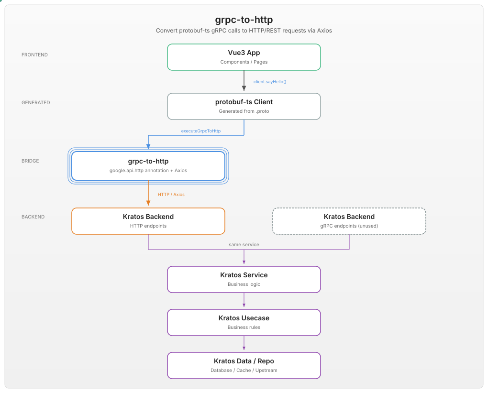

# grpc-to-http

Convert a TypeScript gRPC client into an HTTP client using Axios.

---



---

<!-- TEMPLATE (EN) BEGIN: LANGUAGE NAVIGATION -->

## CHINESE README

[中文说明](README.zh.md)

<!-- TEMPLATE (EN) CLOSE: LANGUAGE NAVIGATION -->

## Features

- Convert protobuf-ts generated gRPC client invocations to HTTP/REST requests
- Use Axios as the HTTP engine
- Automatic path param extraction and rewriting
- GET/POST/PUT/PATCH/DELETE methods via `google.api.http` annotations, with path params, `body: "*"` and `body: "<field>"`
- Snake_case to camelCase param name auto-conversion
- Server-streaming methods read the Server-Sent Events that Kratos v3 sends, one message at a time
- Lightweight with minimum dependencies

## Design

When using [protobuf-ts](https://github.com/timostamm/protobuf-ts) to generate TypeScript gRPC clients, the generated code uses `stackIntercept` and `UnaryCall` as gRPC mechanisms. This package provides `executeGrpcToHttp` and `GrpcToHttpPromise` as drop-in replacements that route requests through HTTP/REST endpoints using Axios instead.

The conversion reads `google.api.http` annotations from `.proto` files to decide:
- HTTP method (GET/POST/PUT/PATCH/DELETE)
- URL path (with param substitution)
- Request payload handling

This is most convenient when the backend (e.g., [Kratos](https://github.com/go-kratos/kratos)) exposes both gRPC and HTTP endpoints, and the frontend uses HTTP without configuring a gRPC bridge.

### Data Format

Messages go in the proto3 JSON form, the protojson form the Go backend reads and writes. The input goes out through `method.I.toJson` and each response comes back through `method.O.fromJson`, as the protobuf-ts twirp transport does, so the code on both ends works with plain protobuf-ts objects:

- `bytes` go as base64 and come back as `Uint8Array`
- enums go as names and come back as numbers, matching the TS enum
- `oneof` members go flat and come back as `{ oneofKind, ... }`
- `google.protobuf.Timestamp` and the rest of the well-known types go in the JSON form of each type and come back as protobuf-ts objects; `google.protobuf.Any` also needs `jsonOptions.typeRegistry` in the options

A Kratos v3 backend must use the protojson codec as its `json` codec. The default `json` codec of Kratos v3 uses `encoding/json`, and its field names (`article_id`) do not match the protojson ones (`articleId`):

```go
import _ "github.com/go-kratos/kratos/contrib/encoding/json/v3"
```

## Related Projects

- [kratos-ts-http](https://github.com/yylego/kratos-ts-http) — Go package that generates the TypeScript clients importing this package. Its protoc plugin emits HTTP-form clients in one step, with nothing staged in between
- [kratos-vue3](https://github.com/yylego/kratos-vue3) — the package that came first, which does the same rewrite as a separate second pass. It keeps working; new projects should take kratos-ts-http
- [kratos-vue3-demo](https://github.com/kratos-examples/vue3) — Complete demo project showing how to use grpc-to-http with Kratos and Vue3

## Setup

```bash
npm install @yylego/grpc-to-http
```

## Usage

Import from the package:

```typescript
import { executeGrpcToHttp, executeGrpcToHttpStream, GrpcToHttpException, grpcToHttpConfig } from '@yylego/grpc-to-http';
import type { GrpcToHttpPromise, GrpcToHttpStream, GrpcToHttpOptions } from '@yylego/grpc-to-http';
```

### API

**`executeGrpcToHttp<I, O>(callType, transport, method, options, input)`**

Execute a gRPC request via HTTP. Arguments:

| Argument | Type | Description |
|----------|------|-------------|
| `callType` | `string` | The gRPC request type (e.g., "unary") |
| `transport` | `RpcTransport` | The protobuf-ts transport mechanism |
| `method` | `MethodInfo<I, O>` | The method info from protobuf-ts |
| `options` | `RpcOptions` | Options including `baseUrl`, `meta` (headers), `abort` (an `AbortSignal` that stops the request), `timeout` (milliseconds, else a `Date` deadline), `jsonOptions` (protobuf-ts JSON options) and `onUploadProgress` (the axios upload progress callback) |
| `input` | `I` | The request input object |

Returns `GrpcToHttpPromise<I, O>` — a Promise that resolves to an Axios response.

**`executeGrpcToHttpStream<I, O>(method, options, input)`**

Execute a server-streaming request (`rpc X(Req) returns (stream Resp)`) via HTTP, reading the Server-Sent Events that Kratos v3 sends. The arguments match `executeGrpcToHttp` without `callType` and `transport`; `options.abort` (an `AbortSignal`) stops the reading, such as when the page closes, while `options.timeout` has no effect on a stream.

Returns `GrpcToHttpStream<I, O>` — an async iterable of `O`, to read with `for await`; it ends when Kratos closes the connection, and a `break` closes the connection at once. A Kratos fault throws an `AxiosError` whose `response.data` is the Kratos error object, the same shape as a unary method, so one catch block handles both. An abort, a network fault throws the `fetch` exception as-is (an `AbortError`, a `TypeError`):

```typescript
const stop = new AbortController(); // stop.abort() ends the reading, such as when the page closes
for await (const resp of executeGrpcToHttpStream(method, { ...options, abort: stop.signal }, input)) {
    text += resp.delta;
}
```

**`grpcToHttpConfig`**

Configuration object. Supported options:

| Option | Type | Default | Description |
|--------|------|---------|-------------|
| `debug` | `boolean` | `false` | When `true`, prints request details to console |

**`GrpcToHttpException`**

Custom exception class thrown when conversion encounters issues (e.g., missing HTTP method annotation, missing path parameters). Use `instanceof` to distinguish from network exceptions:

```typescript
import { GrpcToHttpException } from '@yylego/grpc-to-http';

try {
    const response = await client.sayHello({ name: 'World' }, options);
} catch (e) {
    if (e instanceof GrpcToHttpException) {
        console.log('Conversion exception:', e.message);
    } else {
        console.log('Network exception:', e);
    }
}
```

**Debug Output**

When `grpcToHttpConfig.debug = true`, one line is printed with each request, once the HTTP request is built:

```
[grpc-to-http] method=SayHello params={"name":"World"} POST http://localhost:8000/api/hello
```

The params are printed as-is, passwords included, so keep the switch off outside development. When the URL cannot be built, the thrown `GrpcToHttpException` names the method, such as `GetArticle: MISSING PARAMETER: id`.

### Code Sample

```typescript
// In a Vue component
import { grpcToHttpConfig } from '@yylego/grpc-to-http';
import type { GrpcToHttpOptions } from '@yylego/grpc-to-http';

// Enable debug mode (optional)
grpcToHttpConfig.debug = true;

const options: GrpcToHttpOptions = {
    baseUrl: 'http://localhost:8000',
    meta: {
        'Authorization': 'token-value-here'
    }
};

// The generated client uses HTTP instead of gRPC
const response = await client.sayHello({ name: 'World' }, options);
```

## Lint

```bash
npx tsc --noEmit
```

## Publish

```bash
npm publish --access=public
```

---

## Previous Version

This package was once published as [@yyle88/grpt](https://www.npmjs.com/package/@yyle88/grpt) on the [yyle88](https://github.com/yyle88) account.

The `yyle88` account has been suspended, so `@yyle88/grpt` is discontinued. Please use `@yylego/grpc-to-http` instead.

---

<!-- TEMPLATE (EN) BEGIN: STANDARD PROJECT FOOTER -->
<!-- VERSION 2025-11-25 03:52:28.131064 +0000 UTC -->

## 📄 License

MIT License - see [LICENSE](LICENSE).

---

## 💬 Contact & Feedback

Contributions are welcome! Report bugs, suggest features, and contribute code:

- 🐛 **Mistake reports?** Open an issue on GitHub with reproduction steps
- 💡 **Fresh ideas?** Create an issue to discuss
- 📖 **Documentation confusing?** Report it so we can improve
- 🚀 **Need new features?** Share the use cases to help us understand requirements
- ⚡ **Performance issue?** Help us optimize through reporting slow operations
- 🔧 **Configuration problem?** Ask questions about complex setups
- 📢 **Follow project progress?** Watch the repo to get new releases and features
- 🌟 **Success stories?** Share how this package improved the workflow
- 💬 **Feedback?** We welcome suggestions and comments

---

## 🔧 Development

New code contributions, follow this process:

1. **Fork**: Fork the repo on GitHub (using the webpage UI).
2. **Clone**: Clone the forked project (`git clone https://github.com/yourname/repo-name.git`).
3. **Navigate**: Navigate to the cloned project (`cd repo-name`)
4. **Branch**: Create a feature branch (`git checkout -b feature/xxx`).
5. **Code**: Implement the changes with comprehensive tests
6. **Testing**: (Golang project) Ensure tests pass (`go test ./...`) and follow Go code style conventions
7. **Documentation**: Update documentation to support client-facing changes
8. **Stage**: Stage changes (`git add .`)
9. **Commit**: Commit changes (`git commit -m "Add feature xxx"`) ensuring backward compatible code
10. **Push**: Push to the branch (`git push origin feature/xxx`).
11. **PR**: Open a merge request on GitHub (on the GitHub webpage) with detailed description.

Please ensure tests pass and include relevant documentation updates.

---

## 🌟 Support

Welcome to contribute to this project via submitting merge requests and reporting issues.

**Project Support:**

- ⭐ **Give GitHub stars** if this project helps you
- 🤝 **Share with teammates** and (golang) programming friends
- 📝 **Write tech blogs** about development tools and workflows - we provide content writing support
- 🌟 **Join the ecosystem** - committed to supporting open source and the (golang) development scene

**Have Fun Coding with this package!** 🎉🎉🎉

<!-- TEMPLATE (EN) CLOSE: STANDARD PROJECT FOOTER -->
