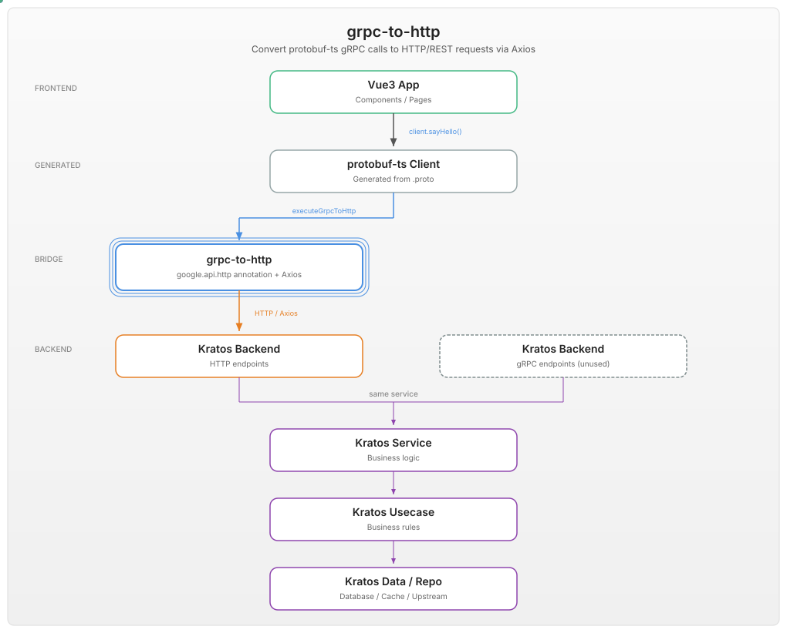

# grpc-to-http

将 TypeScript gRPC 客户端转换为基于 Axios 的 HTTP 客户端。

---



---

<!-- TEMPLATE (ZH) BEGIN: LANGUAGE NAVIGATION -->

## 英文文档

[ENGLISH README](README.md)

<!-- TEMPLATE (ZH) CLOSE: LANGUAGE NAVIGATION -->

## 功能特性

- 将 protobuf-ts 生成的 gRPC 客户端调用转换为 HTTP/REST 请求
- 使用 Axios 作为 HTTP 传输层
- 自动提取和重写路径参数
- 通过 `google.api.http` 注解支持 GET/POST/PUT/PATCH/DELETE 方法，支持路径参数、`body: "*"` 和 `body: "<字段>"`
- 自动将 snake_case 参数名转换为 camelCase
- 服务端流式调用读取 Kratos v3 推送的 SSE，来一条交出一条
- 轻量级，依赖极少

## 设计思路

使用 [protobuf-ts](https://github.com/timostamm/protobuf-ts) 生成 TypeScript gRPC 客户端时，生成的代码使用 `stackIntercept` 和 `UnaryCall` 进行 gRPC 传输。本包提供 `executeGrpcToHttp` 和 `GrpcToHttpPromise` 作为替代，通过 Axios 将请求转发到 HTTP/REST 端点。

转换过程读取 `.proto` 文件中的 `google.api.http` 注解来确定：
- HTTP 方法（GET/POST/PUT/PATCH/DELETE）
- URL 路径（含参数替换）
- 请求体处理方式

当后端（如 [Kratos](https://github.com/go-kratos/kratos)）同时暴露 gRPC 和 HTTP 端点时，前端可以直接使用 HTTP 调用，无需配置 gRPC 代理。

### 数据格式

消息按 proto3 的 JSON 格式收发，也就是 Go 后端读写的 protojson 格式。请求先经 `method.I.toJson` 转换再发出，响应收到后经 `method.O.fromJson` 转回，跟 protobuf-ts 官方 twirp 传输的做法一样，所以前后端的代码拿到的都是普通的 protobuf-ts 对象：

- `bytes` 按 base64 传输，收回来是 `Uint8Array`
- 枚举按名字传输，收回来是数字，跟 TS 枚举一致
- `oneof` 的成员平铺传输，收回来是 `{ oneofKind, ... }`
- `google.protobuf.Timestamp` 等知名类型按各自的 JSON 写法传输，收回来是 protobuf-ts 对象；`google.protobuf.Any` 还要在选项里传 `jsonOptions.typeRegistry`

Kratos v3 后端必须把 protojson 编解码器注册成 `json`。Kratos v3 默认的 `json` 编解码器用的是 `encoding/json`，字段名（`article_id`）跟 protojson 的（`articleId`）对不上：

```go
import _ "github.com/go-kratos/kratos/contrib/encoding/json/v3"
```

## 关联项目

- [kratos-ts-http](https://github.com/yylego/kratos-ts-http) — Go 包，生成 import 本包的 TypeScript 客户端。它的 protoc 插件一步产出 HTTP 形态客户端，中间不留产物
- [kratos-vue3](https://github.com/yylego/kratos-vue3) — 早先的包，同样的改写要分两步做。它继续可用，新项目建议用 kratos-ts-http
- [kratos-vue3-demo](https://github.com/kratos-examples/vue3) — 完整的演示项目，展示如何配合 Kratos 和 Vue3 使用 grpc-to-http

## 安装

```bash
npm install @yylego/grpc-to-http
```

## 使用

从包中导入：

```typescript
import { executeGrpcToHttp, executeGrpcToHttpStream, GrpcToHttpException, GrpcToHttpTransport, grpcToHttpConfig } from '@yylego/grpc-to-http';
import type { GrpcToHttpPromise, GrpcToHttpStream, GrpcToHttpOptions } from '@yylego/grpc-to-http';
```

### API

**`new GrpcToHttpTransport(options)`**

交给生成的 HTTP 客户端的 transport。它保存每个请求共用的选项（如 `baseUrl` 和 `meta` 里的请求头），并跟单次请求的选项合并。有了它，前端不用再从别的包里拿 transport：

```typescript
const transport = new GrpcToHttpTransport({ baseUrl: 'http://localhost:8000', meta: { Authorization: token } })
const client = new ArticleServiceClient(transport)
```

**`executeGrpcToHttp<I, O>(callType, transport, method, options, input)`**

通过 HTTP 执行 gRPC 调用。参数：

| 参数 | 类型 | 说明 |
|------|------|------|
| `callType` | `string` | gRPC 调用类型（如 "unary"） |
| `transport` | `RpcTransport` | protobuf-ts 传输机制 |
| `method` | `MethodInfo<I, O>` | protobuf-ts 方法信息 |
| `options` | `RpcOptions` | 选项，包含 `baseUrl`、`meta`（请求头）、`abort`（用来取消的 `AbortSignal`）、`timeout`（超时毫秒数，或一个 `Date` 截止时间）、`jsonOptions`（protobuf-ts 的 JSON 选项）和 `onUploadProgress`（axios 的上传进度回调） |
| `input` | `I` | 请求输入对象 |

返回 `GrpcToHttpPromise<I, O>` — 解析为 Axios 响应的 Promise。

**`executeGrpcToHttpStream<I, O>(method, options, input)`**

通过 HTTP 执行服务端流式调用（`rpc X(Req) returns (stream Resp)`），读取 Kratos v3 推送的 SSE。参数跟 `executeGrpcToHttp` 一样，只是没有 `callType` 和 `transport`；传 `options.abort`（一个 `AbortSignal`）可以中途停止读取，比如页面关闭时；`options.timeout` 对流式调用不起作用。

返回 `GrpcToHttpStream<I, O>` — 一个能用 `for await` 读的异步迭代，每次交出一个 `O`，服务端关闭连接时结束，中途 `break` 会马上断开连接。服务端返回的错误抛出 `AxiosError`，`response.data` 是 Kratos 的错误对象，跟一元调用出错的形状一样，一套错误处理两种调用都能用。取消和网络故障抛出 `fetch` 原生的异常（`AbortError` 或 `TypeError`）：

```typescript
const stop = new AbortController(); // 调 stop.abort() 停止读取，比如页面关闭时
for await (const resp of executeGrpcToHttpStream(method, { ...options, abort: stop.signal }, input)) {
    text += resp.delta;
}
```

**`grpcToHttpConfig`**

配置对象。支持的选项：

| 选项 | 类型 | 默认值 | 说明 |
|------|------|--------|------|
| `debug` | `boolean` | `false` | 设为 `true` 时，在控制台打印请求详情 |

**`GrpcToHttpException`**

自定义异常类，在转换遇到问题时抛出（如缺少 HTTP 方法注解、缺少路径参数）。使用 `instanceof` 即可区分转换异常和网络异常：

```typescript
import { GrpcToHttpException } from '@yylego/grpc-to-http';

try {
    const response = await client.sayHello({ name: 'World' }, options);
} catch (e) {
    if (e instanceof GrpcToHttpException) {
        console.log('转换异常:', e.message);
    } else {
        console.log('网络异常:', e);
    }
}
```

**调试输出**

当 `grpcToHttpConfig.debug = true` 时，每次请求在构造完 HTTP 请求后打印一行日志：

```
[grpc-to-http] method=SayHello params={"name":"World"} POST http://localhost:8000/api/hello
```

参数原样打印，密码也会出现在控制台里，所以只在开发时打开。地址拼不出来时，抛出的 `GrpcToHttpException` 会带上接口名，比如 `GetArticle: MISSING PARAMETER: id`。

### 示例

```typescript
// 在 Vue 组件中
import { grpcToHttpConfig } from '@yylego/grpc-to-http';
import type { GrpcToHttpOptions } from '@yylego/grpc-to-http';

// 开启调试模式（可选）
grpcToHttpConfig.debug = true;

const options: GrpcToHttpOptions = {
    baseUrl: 'http://localhost:8000',
    meta: {
        'Authorization': 'token-value-here'
    }
};

// 生成的客户端自动使用 HTTP 而非 gRPC
const response = await client.sayHello({ name: 'World' }, options);
```

## 代码检查

```bash
npx tsc --noEmit
```

## 发布

```bash
npm publish --access=public
```

---

## 旧版本说明

本包的前身是 [@yyle88/grpt](https://www.npmjs.com/package/@yyle88/grpt)，由 [yyle88](https://github.com/yyle88) 发布。

由于 `yyle88` 账号已被封禁，`@yyle88/grpt` 不再维护。请使用 `@yylego/grpc-to-http` 替代。

---

<!-- TEMPLATE (ZH) BEGIN: STANDARD PROJECT FOOTER -->
<!-- VERSION 2025-11-25 03:52:28.131064 +0000 UTC -->

## 📄 许可证类型

MIT 许可证 - 详见 [LICENSE](LICENSE)。

---

## 💬 联系与反馈

非常欢迎贡献代码！报告 BUG、建议功能、贡献代码：

- 🐛 **问题报告？** 在 GitHub 上提交问题并附上重现步骤
- 💡 **新颖思路？** 创建 issue 讨论
- 📖 **文档疑惑？** 报告问题，帮助我们完善文档
- 🚀 **需要功能？** 分享使用场景，帮助理解需求
- ⚡ **性能瓶颈？** 报告慢操作，协助解决性能问题
- 🔧 **配置困扰？** 询问复杂设置的相关问题
- 📢 **关注进展？** 关注仓库以获取新版本和功能
- 🌟 **成功案例？** 分享这个包如何改善工作流程
- 💬 **反馈意见？** 欢迎提出建议和意见

---

## 🔧 代码贡献

新代码贡献，请遵循此流程：

1. **Fork**：在 GitHub 上 Fork 仓库（使用网页界面）
2. **克隆**：克隆 Fork 的项目（`git clone https://github.com/yourname/repo-name.git`）
3. **导航**：进入克隆的项目（`cd repo-name`）
4. **分支**：创建功能分支（`git checkout -b feature/xxx`）
5. **编码**：实现您的更改并编写全面的测试
6. **测试**：（Golang 项目）确保测试通过（`go test ./...`）并遵循 Go 代码风格约定
7. **文档**：面向用户的更改需要更新文档
8. **暂存**：暂存更改（`git add .`）
9. **提交**：提交更改（`git commit -m "Add feature xxx"`）确保向后兼容的代码
10. **推送**：推送到分支（`git push origin feature/xxx`）
11. **PR**：在 GitHub 上打开 Merge Request（在 GitHub 网页上）并提供详细描述

请确保测试通过并包含相关的文档更新。

---

## 🌟 项目支持

非常欢迎通过提交 Merge Request 和报告问题来贡献此项目。

**项目支持：**

- ⭐ **给予星标**如果项目对您有帮助
- 🤝 **分享项目**给团队成员和（golang）编程朋友
- 📝 **撰写博客**关于开发工具和工作流程 - 我们提供写作支持
- 🌟 **加入生态** - 致力于支持开源和（golang）开发场景

**祝你用这个包编程愉快！** 🎉🎉🎉

<!-- TEMPLATE (ZH) CLOSE: STANDARD PROJECT FOOTER -->
